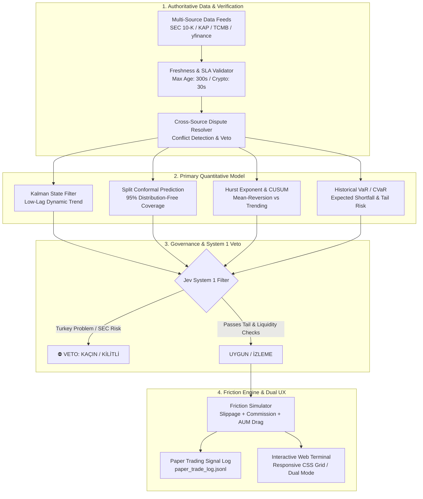

# ⛏️ Shovel — Quantitative Market & Risk Terminal

[](https://python.org)
[](https://opensource.org/licenses/MIT)
[](https://github.com)
[](https://github.com)
[](https://github.com)

**Shovel** is an institutional-grade quantitative finance and market risk terminal designed for multi-asset decision support, dynamic volatility regime modeling, and execution friction simulation. 

It implements non-parametric **Conformal Prediction**, **Kalman state filters**, **Hurst exponent regime estimation**, and **Historical CVaR (Expected Shortfall)**, operating with a deterministic **System 1 (Via Negativa) veto filter**.

> [!IMPORTANT]
> **Academic & Paper Trading Disclaimer:** Shovel is strictly a quantitative research and paper trading terminal. `REAL_TRADING_ENABLED` is hardcoded to `false`. It does not execute live market orders or claim guaranteed financial outperformance. All returns are simulated under realistic implementation shortfall models.

---

## 🏛️ System Architecture



---

## ✨ Key Features

### 1. Zero-Lag Quant Decision Layer
- **Kalman Trend Filter:** Replaces lagging indicators (RSI, MACD, moving averages) as the primary decision driver. Measures instantaneous trend slope with minimal lag.
- **Conformal Prediction Intervals:** Produces mathematically guaranteed $\alpha=0.05$ coverage intervals without assuming Gaussian return distributions.
- **Hurst Exponent ($H$):** Discerning persistent trending regimes ($H > 0.55$) from mean-reverting ranges ($H < 0.45$).
- **CUSUM Breakout Detector:** Identifies sudden volatility and variance shifts before standard moving averages react.

### 2. Realistic Execution Friction Engine
Most retail backtests suffer from over-optimism. Shovel applies institutional **Implementation Shortfall**:
- **Exchange Fees:** Fixed $1.50 per US order, 0.20% for BIST.
- **Dynamic Slippage:** 2 bps for mega-caps (AAPL, NVDA), 10 bps for volatile commodities & mining ETFs (SILJ, XAG, BTC).
- **AUM Drag:** 1.25% annualized tracking cost applied daily.

### 3. Multi-Asset Controlled Rollout
- **BIST Equities:** Primary active quant decision engine (`UYGUN`, `İZLEME`, `KAÇIN`).
- **US Equities & Big Tech:** Shadow / Parallel model running alongside legacy baseline for research benchmark.
- **Commodities & FX:** Physical gold/silver parity, inflation hedge monitors, central bank shock radar.
- **Crypto Quant Lab:** High-frequency L2 order book imbalance and volatility research (Isolated data mode).

### 4. Dual Terminal Experience (Pro Quant & Family Compass)
- **🔬 Pro Quant Mode:** Full academic metrics, conformal bounds, CVaR matrices, and TradingView charts.
- **🧭 Family Compass Mode:** Translates complex stochastic outputs into 3 simple family questions:
  1. *Is our capital protected against inflation?*
  2. *What action is required today? (Wait / Rebalance / Hold)*
  3. *What is our real purchasing power net worth?*

---

## 🌐 Live Web Terminal (GitHub Pages)

The interactive quantitative terminal is live and hosted directly on GitHub Pages with zero installation required:

👉 **[Launch Shovel Live Terminal](https://necatcihans.github.io/shovel/)**

---

## 📊 Local Preview

The terminal is written in pure vanilla HTML5, TailwindCSS, and JavaScript with zero external backend dependencies required for rendering:

```bash
# Clone the repository
git clone https://github.com/necatcihans/shovel.git
cd shovel

# Open the terminal in your default browser
# Windows:
start index.html
# macOS:
open index.html
# Linux:
xdg-open index.html
```

Or deploy directly via **GitHub Pages** with zero build configuration!

---

## 🧪 Verification & Test Suite

All quantitative models and governance rules are covered by deterministic tests:

```bash
# Run primary quant engine & timeframe noise tests
python tests/test_shovel_quant_primary_and_timeframe.py

# Run academic calibration & robustness validation
python tests/test_robust_quant_and_academic_validation.py

# Run active multi-asset resolver tests
python tests/test_active_asset_resolver.py

# Run crypto quant lab L2 tests
python tests/test_crypto_quant_lab.py

# Run full CI/CD verification & compile protected virtual runtime
python build_dist.py
```

---

## 📁 Repository Structure

```text
├── index.html                           # Standalone live interactive web terminal
├── Shovel.html                          # Development source terminal
├── Shovel_Protected.html                # Compiled client-side encrypted runtime
├── build_dist.py                        # Automated build & CI/CD compiler
│
├── shovel_primary_quant_engine.py       # Kalman, Conformal, Hurst & CVaR engine
├── shovel_controlled_rollout_engine.py  # Multi-asset rollout controller
├── shovel_lag_free_quant.py             # Zero-lag state-space estimators
├── shovel_crypto_engine.py              # Crypto L2 order book depth analytics
├── shovel_decision_chain.py             # UYGUN / İZLEME / KAÇIN pipeline
├── shovel_asset_resolver.py             # SEC/KAP canonical symbol resolver
├── shovel_freshness_engine.py           # Timestamp SLA & stale data monitor
├── shovel_governance.py                 # Fail-closed risk gates & veto rules
│
├── config/
│   └── shovel_quant_decision_config.json # Calibrated hyper-parameters & tolerances
├── tests/
│   ├── test_shovel_quant_primary_and_timeframe.py
│   ├── test_robust_quant_and_academic_validation.py
│   ├── test_active_asset_resolver.py
│   ├── test_governance_and_reliability.py
│   └── test_crypto_quant_lab.py
└── reports/
    ├── shovel_real_backtest_report.md
    └── shovel_controlled_rollout_report.json
```

---

## 📜 License & Intellectual Property

Distributed under the **MIT License**. See [`LICENSE`](LICENSE) for more information.

Developed by **Necat Cihan Şen** (Gebze Technical University — Mathematics).
